  

  
  
  
  
  
  
  
  

---

# Mohamed Wael JOUINI
**GIS Manager | Spatial Data Engineer | Geospatial & AI Systems Architect**

> *From utility network infrastructure to spatial AI: structuring, automating, and scaling geographic data for territories and enterprise decision systems.*

---

## Profile

Senior GIS Manager and Spatial Data Engineer with extensive experience in enterprise geospatial infrastructure, spatial ETL automation (Safe Software FME, Python, PyQGIS), utility network modeling (drinking water, wastewater, stormwater), WebGIS architecture, and Agentic AI integration. Double Master's graduate in Geomatics, Remote Sensing, and Urban Planning, with a proven track record of architecting high-reliability spatial pipelines, official QGIS plugins, and production Model Context Protocol (MCP) tooling. Creator of **`fme-mcp-ultra`**, the production-grade MCP server bridging enterprise GIS with autonomous AI agents.

---

## Core Pillars of Expertise

| Utility Networks & GIS Administration | Spatial ETL & Automation (FME / Python / MCP) |
| :--- | :--- |
| Structuring and governance of utility network data (Drinking Water, Wastewater, Stormwater) compliant with French national standards **STAR-Eau** and **RAEPA**, integration of **STAR-DT** as-built surveys, CCTV pipeline inspection (**ITV**) validation, and operational performance indicators. | Enterprise geospatial workflows automated with certified **FME Form Advanced**, custom **PyQGIS** development, production-grade Python automation suites, and Model Context Protocol (MCP) servers connecting GIS engines to autonomous AI agents. |
| **Urban Planning & Statutory Land Use (ADS)** | **WebGIS Infrastructure & Cloud Servers** |
| Digitization of municipal master plans (**PLU**), public utility easements (**SUP**), cadastral fabric integration (PCI Etalab), and spatial analysis supporting statutory planning and building permit reviews. | Production **GeoServer** map servers, **Linux (Debian/Ubuntu)** & **Windows Server** administration, Bash/PowerShell scripting, and high-performance databases with **PostgreSQL / PostGIS**. |

---

## Featured Projects & Engineering Work

| Project | Domain & Technologies | Links |
| :--- | :--- | :---: |
|  **fme-mcp-ultra** *(Flagship MCP Server & PyPI Package)* | Universal Model Context Protocol (MCP) server for Safe Software FME (2018.0 - 2026+), FME Form Desktop and FME Flow. Enables autonomous AI agents (Claude Code, Cursor, Codex, QGIS, Agensi) to introspect, parse, diagnose, execute workspaces, inspect visual canvas pipelines, and automate enterprise spatial ETL. Official PyPI release, verified with 32 automated test suites, zero-config FME bridge, and sub-10ms path & command security sandboxing. | [PyPI Package](https://pypi.org/project/fme-mcp-ultra/) • [GitHub Repository](https://github.com/mwjouini/fme-mcp-ultra) • [Glama Registry](https://glama.ai/mcp/servers/mwjouini/fme-mcp-ultra) |
| **QGIS CAD Suite** *(Flagship QGIS 3.x / 4.x Plugin)* | Professional CAD/CAO suite embedded into QGIS replicating the AutoCAD 2025 engineering environment (full Ribbon, crosshair cursor, real-time visual OSNAP object snapping, floating command line with `QCompleter` autocompletion, ByLayer properties, pre-import heuristic CRS detection, geometric conversion to Lambert-93, and ISO 7200 A3/A4 engineering title blocks). | [GitHub Repository](https://github.com/mwjouini/qgis-cad-suite) • [Download Release (ZIP)](https://github.com/mwjouini/qgis-cad-suite/releases/latest) |
| **OpenGeoData France** *(Official QGIS Plugin)* | Unified search and direct import engine for French open geospatial data (IGN GéoPlateforme, Cadastre PCI Etalab, GPU Urbanisme, BAN, Live Weather, historical 1950s orthophotos & Pléiades high-resolution satellite imagery) with multi-scale territorial filtering (Regions, Departments, Intercommunalities, Municipalities). | [QGIS Plugin Portal](https://plugins.qgis.org/plugins/OpenGeoDataFR/) • [GitHub Repository](https://github.com/mwjouini/OpenGeoData-France) |
| **GeoBan France** *(Official QGIS Plugin)* | Official QGIS plugin developed in PyQGIS enabling instant address geocoding (French National Address Database BAN API) and cadastral parcel lookups (IGN APICarto API) with one-click print-ready PDF/A4 cartographic layouts. | [QGIS Plugin Portal](https://plugins.qgis.org/plugins/geoban_france/) • [GitHub Repository](https://github.com/mwjouini/GeoBan-France) |
| **SPANC & Hydra Enterprise WebGIS Platform** *(Production CC des Sablons)* | Integrated enterprise web platform for managing, diagnosing, and inspecting on-site sanitation facilities (SPANC & Hydra). Features Leaflet interactive mapping with IGN Parcellaire Express cadastral parcels, universal stylus/touch digital signatures (`SignaturePad v5`), dynamic multi-step forms with progress tracking, automated generation of certified PDF inspection reports with georeferenced cadastral plans, and a Flask / PostgreSQL stack running on Linux Debian. | [Access Web Portal](https://spanc.cc-sablons.com) |
| **STAR-Eau Utility Network GIS Infrastructure** | Standardized geospatial modeling and asset management for drinking water, wastewater, and stormwater infrastructure compliant with French STAR-Eau (RAEPA) standards, automated as-built survey integration, and compliance dashboards. | *Intercommunal Infrastructure* |

---

## Professional Experience

### GIS Manager
**Communauté de Communes des Sablons** | *Feb. 2024 – Present* | France
- Oversee and administer enterprise GIS datasets for wastewater, stormwater, and drinking water networks compliant with STAR-Eau and RAEPA geostandards.
- Integrate contractor as-built plans, CCTV pipe inspection reports (ITV), leak detection surveys, and regulatory compliance audits.
- Build and monitor operational KPIs on utility coverage, network condition, and municipal asset lifecycle.
- Manage spatial datasets supporting statutory planning and building permit reviews (ADS): Local Master Plans (PLU), public utility easements (SUP), and cadastral parcels.
- Expand the intercommunal spatial data catalog: road infrastructure, housing, tourism, public transit, and waste management.
- Maintain and scale web mapping applications and desktop GIS tools; provide technical support and customize GIS tooling to match operational business workflows.
- Maintain and enhance the SPANC WebGIS platform, oversee electronic signature workflows, and author FME automation workspaces for network data ingestion and continuous synchronization.

### Geomatician / GIS Engineer
**G’AUCUBE – Geoscience & Geomatics Consultancy** | *2023 – 2024* | Île-de-France, France
- Authored engineering technical reports and spatial cartographic deliverables for major infrastructure utility networks.
- Located and georeferenced underground utility networks in national legal coordinate reference systems (RGF93 / Lambert-93).
- Built and configured a centralized GIS platform for geothermal district heating as-built tracking.
- Generated multi-utility as-built surveys: electricity, drinking water, wastewater, stormwater, fiber optics, telecom, and district heating (STAR-DT compliant).

### GIS Intern
**G’AUCUBE – Geoscience & Geomatics Consultancy** | *2022* | Rueil-Malmaison, France
- Contributed to district heating GIS workflows in Rueil-Malmaison.
- Drafted geothermal network as-built maps and structured concessionaire utility databases.
- Deployed an interactive WebGIS platform with public and private user tiers.

### GIS Intern
**Coastal Protection and Planning Agency (APAL)** | *2021* | Tunisia
- Implemented a mobile GIS application for field beach occupancy and concession surveys.
- Developed a mobile data collection system to store, manage, and query geospatial field data.
- Participated in coastal defense planning for the Bizerte shoreline and trained municipal staff on QGIS.

### GIS Project Officer
**NourGis Consulting** | *2019 – 2020* | Tunisia
- Contributed to coastal planning and zone management projects across Greater Tunis and Sousse.
- Programmed beach zoning plans and built a structured GIS repository to enhance coastal space stewardship.
- Produced detailed cartographic atlases and environmental sensitivity maps.

### GIS & Urban Planning Intern
**Ministry of Equipment, Housing and Infrastructure** | *2018 (4 months)* | Tunisia
- Conducted spatial research on establishing an Urban GIS for the city of Raoued.
- Assisted in the revision of the Urban Master Plan (PAU) and proposed spatial coherence guidelines.
- Modeled the municipal geographic database for land use patterns and public facilities.

---

## Certifications & Continuing Education

-  **FME Form Advanced** *(Safe Software / Avineon Tensing)* — June 2025
-  **FME Form Basic** *(Safe Software)* — July 2024
-  **AIPR Designer** *(Network Damage Prevention Accreditation)* — May 2023

---

## Technical Skills & Tooling

- **GIS, Cartography & CAD**: QGIS, AutoCAD, MicroStation, DWG/DXF/GeoPackage Interoperability, ArcGIS Pro, WebGIS & Mobile GIS, Georeferencing, Thematic Mapping, Spatial Analysis, As-Built Surveying.
- **Databases & Interoperability**: PostgreSQL, PostGIS, GeoServer, Safe Software FME Form / Flow, CCTV Inspection Reports (ITV), Automated Ingestion Pipelines.
- **Geostandards & Regulations**: STAR-Eau, RAEPA, STAR-DT, Cadastre PCI Etalab, Statutory Planning (PLU / SUP), Building Permit Review (ADS).
- **Development & Cloud Systems**: Python (PyQGIS, Typer, Flask, Pydantic), MCP (Model Context Protocol), JavaScript (Leaflet, OpenLayers), Linux (Ubuntu/Debian), Nginx, Apache, Windows Server, PowerShell, Bash.
- **Technical Leadership**: Stakeholder training, user support, engineering documentation, cross-functional project management, public contractor supervision.

---

## Education & Degrees

- **Master’s Degree in Urban Planning and Territorial Development**  
  National School of Architecture and Urbanism (ENAU) | *2018 – 2022*
- **Master’s Degree in Geomatics Sciences: GIS and Remote Sensing**  
  Faculty of Mathematical, Physical and Natural Sciences of Tunis | *2019 – 2021*
- **Bachelor’s Degree in Construction and Urban Planning (Operational Urbanism)**  
  ISTEUB | *2015 – 2018*
- **Baccalaureate in Technical Sciences**  
  Lycée Ibn Abi Dhief | *2014 – 2015*

---

## Languages

- **English**: Fluent / Professional Working Proficiency
- **French**: Bilingual / Native-level
- **Arabic**: Native Language
- **German**: Intermediate / Working Knowledge

---

## Contact & Connect

- 📍 **Location**: France
- 📧 **Email**: [mohamed.wael.jouini@gmail.com](mailto:mohamed.wael.jouini@gmail.com)
- 💼 **LinkedIn**: [linkedin.com/in/jouinimohamedwael](https://www.linkedin.com/in/jouinimohamedwael)
- 🐙 **GitHub**: [github.com/mwjouini](https://github.com/mwjouini)
- 📦 **PyPI**: [pypi.org/project/fme-mcp-ultra](https://pypi.org/project/fme-mcp-ultra/)
- 🗺️ **Projects & Extensions**: [fme-mcp-ultra](https://github.com/mwjouini/fme-mcp-ultra) • [QGIS CAD Suite](https://github.com/mwjouini/qgis-cad-suite) • [OpenGeoData France](https://plugins.qgis.org/plugins/OpenGeoDataFR/) • [GeoBan France](https://plugins.qgis.org/plugins/geoban_france/) • [SPANC Web Portal](https://spanc.cc-sablons.com)
- 📄 **Full Resume**: [Download CV (PDF)](CV_Mohamed_Wael_Jouini.pdf)
